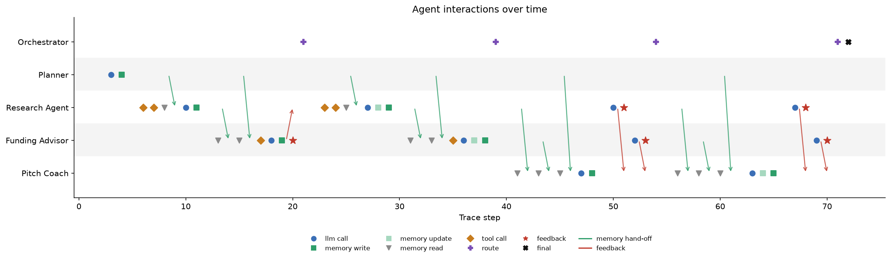

# Multi-Agent Workflow Planner for a Startup Accelerator

A LangGraph system that gives a startup founder a small team of AI agents (a **Research Agent**,
a **Funding Advisor** and a **Pitch Coach**) that plan together, share context through a vector
memory, critique each other's work, and produce a founder-ready **pitch deck outline** from a
single input: the startup's domain (for example *healthtech* or *fintech*).

Everything runs from one notebook: `Startup_Accelerator_Agents.ipynb`. The saved notebook includes
the outputs of a complete demo run (domain: *healthtech*); see [Results of the demo run](#results-of-the-demo-run).

---

## Quick start

```bash
pip install -r requirements.txt
cp .env.example .env        # add the Azure OpenAI endpoint, key, API version, deployment
jupyter notebook Startup_Accelerator_Agents.ipynb
```

> **Note:** some browsers drop the leading dot from file names when downloading. If you see `env`,
> `env.example` or `gitignore.txt`, rename them to `.env`, `.env.example` and `.gitignore`. The
> notebook only reads a file named exactly `.env`, in the folder Jupyter is started from.
>
> Accepted setting names: `AZURE_OPENAI_ENDPOINT` / `AZURE_API_BASE`, `AZURE_OPENAI_API_KEY` /
> `AZURE_API_KEY`, `OPENAI_API_VERSION` / `AZURE_OPENAI_API_VERSION` / `AZURE_API_VERSION`, and
> `AZURE_CHAT_DEPLOYMENT` (defaults to `gpt-5-mini`).

Set `DOMAIN` and, optionally, `FOUNDER_CONTEXT` in section 8, then run all cells. Because of the
gateway's token limit, calls are spaced out and a run takes roughly 15–25 minutes. Each run
writes a folder under `runs/<timestamp>_<domain>/` containing:

| File | What it is |
|---|---|
| `pitch_outline.md` | The final pitch deck outline, funding options, gaps and review result |
| `trace.jsonl` | Structured log of every event: LLM calls, reasoning, tool calls, memory reads and writes, hand-offs, feedback, routing |
| `trace_narrative.md` | Step-by-step narrative of how the agents reached the output, generated from the trace |
| `swimlanes.png` | Timeline of agent activity with hand-off and feedback arrows |
| `workflow_graph.mmd` | The LangGraph graph as Mermaid (render it at mermaid.live) |
| `memory.json` | Final contents of the shared vector memory |
| `final_state.json` | Full final LangGraph state |

**Optional extras** (set in `.env`): `TAVILY_API_KEY` for live web search,
`AZURE_EMBEDDING_DEPLOYMENT` for Azure embeddings in memory, and `LANGSMITH_API_KEY` for
LangSmith tracing alongside the local logs.

---

## 1. System architecture

```
                     ┌──────────────────────────── Shared vector memory ────────────────────────────┐
                     │  every agent writes its findings; the next agent retrieves by similarity     │
                     └──────────────────────────────────────────────────────────────────────────────┘
                              ▲ write / read        ▲ write / read         ▲ write / read
 domain ─► Planner ─► Research Agent ─► Funding Advisor ──(questions?)──► Research Agent (follow-up, max 1)
                                              │                                    │
                                              ▼                                    ▼
                                         Pitch Coach ◄──── requested changes ── Peer review
                                              │                                (Research + Funding
                                              └──────────────► Peer review ──► review the draft)
                                                                    │ approved, or round limit reached
                                                                    ▼
                                                                Finalize ─► pitch_outline.md
          Trace logger: every node, LLM call, tool call, memory read/write, hand-off and route → trace.jsonl
```

**Components**

| Component | Implementation |
|---|---|
| Orchestration | LangGraph `StateGraph` with six nodes and two conditional edges (the feedback loops) |
| LLM | Azure OpenAI through `langchain_openai.AzureChatOpenAI` (gateway, default deployment `gpt-5-mini`) |
| Agent outputs | Pydantic schemas via `with_structured_output`, so hand-offs are typed, not free text |
| Shared memory | `VectorMemory`: NumPy cosine-similarity store; Azure embeddings if configured, otherwise a local hashing embedding |
| Tools | Optional Tavily web search (REST) for the Research Agent and Funding Advisor, cached per run |
| Rate-limit handling | Calls spaced at least 20 s apart, automatic 65 s wait-and-retry on HTTP 429, and a cap of ~3,500 estimated tokens per prompt (settings in section 6) |
| Tracing | `TraceLogger` writes JSONL locally; LangSmith is switched on automatically if a key is present |
| Visuals | Mermaid graph export, Matplotlib swimlane timeline, hand-off matrix, generated narrative |

---

## 2. Agents: logic and responsibilities

The roles are scoped so that each agent **owns one type of output** and is told what it must not do.

| Agent | Owns | Must not | Reads from memory | Writes to memory |
|---|---|---|---|---|
| **Planner** (orchestrator) | Work plan: research questions, funding questions, pitch requirements, success criteria | Answer the questions itself | – | Plan items |
| **Research Agent** | Market trends (each with a confidence level and source), target customers, competitors, risks, open questions | Recommend funding or write slides | Planner's research questions | Insights |
| **Funding Advisor** | Recommended stage, ranked funding options (each linked to a research insight), funding narrative | Generate market data (it asks Research instead) or write slides | Research insights, Planner's funding questions | Funding options |
| **Pitch Coach** | 10–12 slide outline, one-line pitch, evidence per slide, gaps the founder must fill | Introduce facts or programs not supplied by peers | Research insights, funding options, pitch requirements | Slides |

As reviewers, the Research Agent checks the outline's market claims against its own research, and
the Funding Advisor checks the ask, stage and use of funds against its funding plan. Each reviews
only within its own expertise.

All agents share **accuracy guardrails**: no invented statistics, program names or URLs; figures
only from web results or peer input, with citations; anything from model knowledge labelled
*"model knowledge - verify"*; and a reminder to verify funding eligibility and deadlines.

---

## 3. Coordination flow and feedback loops

1. **Planner** turns the domain into a work plan and stores the questions in memory.
2. **Research Agent** retrieves its questions from memory, optionally searches the web, and
   stores each insight as a separate memory item.
3. **Funding Advisor** retrieves the research insights by similarity search (a logged
   *hand-off*), builds a funding plan, and can send questions back to Research.
4. **Feedback loop 1 (Funding → Research):** if the Funding Advisor asked questions, the router
   sends the flow back to the Research Agent, which answers them and updates its report. The
   Funding Advisor then re-plans with the new evidence. This happens at most once.
5. **Pitch Coach** retrieves research, funding and requirements from memory and drafts the outline.
6. **Feedback loop 2 (peer review → Pitch Coach):** the Research Agent and Funding Advisor each
   review the draft and approve it or request changes. If changes are requested and review rounds
   remain (`max_review_rounds`, default 2), the Pitch Coach revises and lists what it changed.
7. **Finalize** writes the outline, funding options, gaps and final review scores to Markdown.

When an agent rewrites its output after feedback, its earlier memory items are marked
**superseded**, so later agents retrieve only the current version. The history stays in
`memory.json`.

---

## Results of the demo run

Domain *healthtech*, founder context: *pre-seed team building an AI triage assistant for rural
primary-care clinics*. Azure OpenAI `gpt-5-mini` through the gateway; web search and Azure
embeddings were off, so the agents worked from model knowledge and the local hashing embeddings.

| Measure | Result |
|---|---|
| LLM calls | 11 (Planner 1, Research Agent 4, Funding Advisor 4, Pitch Coach 2) |
| Model time | about 9.5 minutes in total, plus pacing between calls |
| Trace events | 72 steps logged to `trace.jsonl` |
| Shared memory | 100 items written (earlier versions marked superseded after revisions) |
| Feedback loop 1 | Triggered: the Funding Advisor sent 2 questions to the Research Agent, which answered them before the Funding Advisor re-planned |
| Feedback loop 2 | Triggered: round 1, the Research Agent approved (4/5) and the Funding Advisor requested changes (3/5); the Pitch Coach revised and added a pilot timeline, funding scenarios and procurement metrics |
| Final review | Round 2: neither reviewer approved (Research 3/5, Funding 2/5). The workflow stopped at the 2-round limit and finalized, recording the open feedback |
| Output | A 12-slide outline with evidence and contributing agents per slide, 5 funding routes, founder gaps and open research questions |

The demo outputs are in `sample_output/` (copied from the run folder):
[`pitch_outline.md`](sample_output/pitch_outline.md),
[`trace_narrative.md`](sample_output/trace_narrative.md),
[`trace.jsonl`](sample_output/trace.jsonl) and the timeline below.



**What the run shows.** The agents stayed within their roles, every slide cites the memory items
it draws on, and all dollar figures are labelled "model knowledge - verify", as the guardrails
require. The final reviews were *not* approvals, which is the expected cost of capping review rounds:
the founder gets a usable draft plus an explicit record of what reviewers still wanted. Because web
search was off, the funding routes are generic categories (foundations, district procurement,
accelerators, angels) rather than named programs, and every figure needs verification.

---

## 4. Why LangGraph (framework choice)

The brief allows CrewAI, LangGraph or AutoGen.

- **The workflow is a fixed pipeline with two conditional loops.** LangGraph models this
  directly as a state graph with conditional edges, and the loop limits are explicit, testable
  code rather than something the LLM decides.
- **Typed shared state.** The graph state carries each agent's structured output, which makes
  hand-offs and the trace precise.
- **Traceability.** Every routing decision is a plain Python function I can log, and the graph
  can be exported as a diagram.
- **Compared with the alternatives:** CrewAI's sequential and hierarchical processes are quick
  to set up, but peer-review loops are less explicit. AutoGen's conversational group chat suits
  open-ended dialogue, but makes the order of turns and the number of iterations harder to
  guarantee. For this task, predictable control flow mattered more than free-form conversation.

---

## 5. Challenges and trade-offs

| Challenge | What I did | Trade-off |
|---|---|---|
| **Hallucinated statistics and funding programs**, the biggest risk for founder advice | Guardrails in every prompt, a `source` and `confidence` on every insight and funding option, optional live web search, peer review against each agent's own work | The outline is more cautious and includes "verify" notes; without Tavily, sources are model knowledge only |
| **Endless feedback loops** | Hard limits: one research follow-up, `max_review_rounds` peer reviews, plus LangGraph's `recursion_limit` | The outline may finalize with feedback still open; it is recorded in the trace and review scores |
| **Context growth** when passing full transcripts between agents | Shared vector memory with top-k retrieval, filtered by author | Retrieval can miss a relevant item; I chose larger *k* for the Pitch Coach |
| **Stale context after revisions** | Superseding earlier items of the same kind | Older reasoning is no longer retrievable by agents (still kept on disk) |
| **No embedding deployment on the lab gateway** (possible) | Local hashing embedding fallback | Keyword-level similarity instead of semantic similarity |
| **"Reasoning paths" without exposing hidden chain-of-thought** | Each agent returns a short `reasoning` field, logged with its output | This is the model's own summary of its rationale, not a full record of its internal reasoning |
| **Course gateway rate limit (HTTP 429)**: the first runs failed at peer review. Retries didn't help because one ~6,300-token request was larger than the gateway accepts at once | Shorter summaries in review prompts, a ~3,500-token cap per prompt, 20 s pacing between calls, and wait-and-retry on 429 | Runs are slower (15–25 min), and a capped prompt can lose context (see next row) |
| **Prompt trimming drops the end of a prompt.** In the demo run the Pitch Coach's revision prompt (~4,200 tokens) was trimmed to fit. Peer feedback is placed first, so it survived, but the tail (probably part of the research and funding input and the closing instructions) was cut | Logged as a `prompt_trimmed` event so it is visible in the trace | A better fix is to shrink the retrieved memory for revisions rather than cut text; listed under extensions |
| **Questions sent to the wrong agent.** The Funding Advisor asked the Research Agent which country the founder will pilot in and at what scale. Only the founder can answer this | The Research Agent answered with what it could and listed the rest as open questions | A "questions for the founder" channel (a human-in-the-loop step) would handle this properly |
| **Cost and latency** | 11 LLM calls in the demo run; web results cached per run | More review rounds might improve quality but add calls, time and rate-limit pressure |
| **Model constraints** | No `temperature` set, since gpt-5-family deployments accept only the default | Less control over output variability |

---

## 6. Possible extensions

- Shrink retrieved memory before trimming, so no prompt loses its instructions
- Route questions that only the founder can answer to a human-in-the-loop step (LangGraph interrupts)
- Turn on Tavily web search so funding routes name verifiable programs with source links
- Log the web-search step as "skipped" when no search key is set (it currently logs a search with 0 results)
- A Streamlit front end for founders
- Persisting memory across sessions (for example FAISS or Chroma) so a founder's team remembers earlier work
- A human-in-the-loop approval checkpoint before finalizing
- Export of the outline directly to slides

---

## Notes and limitations

- Tested on an Ubuntu lab VM in VS Code, using a Python virtual environment and
  Azure OpenAI gateway (`gpt-5-mini`).
- The `reasoning` text in the trace is each agent's own short summary of its choices, not a record
  of the model's internal reasoning.
- Package versions are not pinned. If an API has changed, check the current LangGraph and
  `langchain-openai` documentation.
- Tavily is called through its REST API (`https://api.tavily.com/search`); check Tavily's
  current documentation if authentication fails.
- Funding programs, amounts and deadlines in any output must be verified with the program before
  a founder relies on them.
